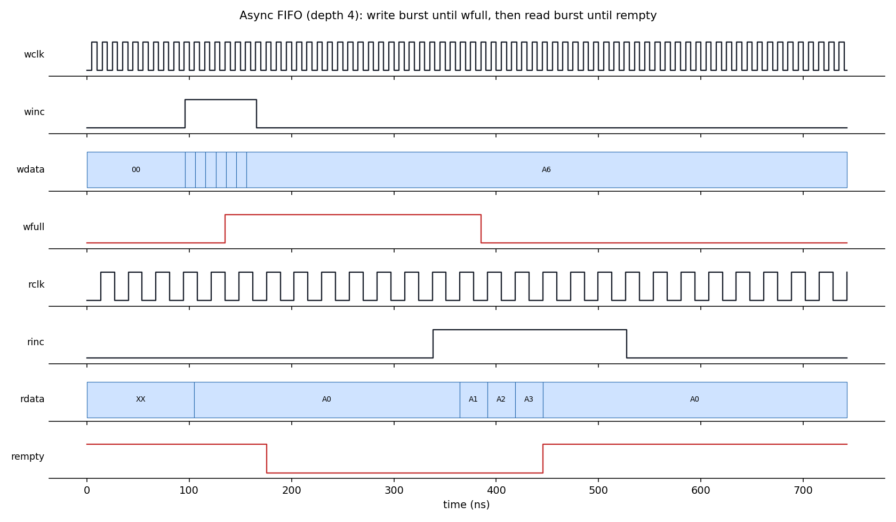
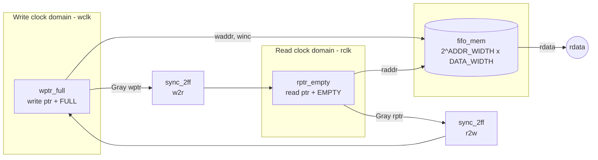

# Asynchronous FIFO (Verilog)

A parameterizable **dual-clock (asynchronous) FIFO** in synthesizable Verilog-2001, with a self-checking testbench, Vivado/Icarus simulation scripts, example CDC constraints, and full documentation.

It safely passes data between two **unrelated clock domains** using Gray-coded pointers and two-flop synchronizers, following the classic design approach of Clifford E. Cummings (*"Simulation and Synthesis Techniques for Asynchronous FIFO Design"*, SNUG 2002).



## Features

- Independent write and read clocks and resets (active-low, asynchronous)
- Parameterizable data width and depth (`DATA_WIDTH`, `ADDR_WIDTH`; depth = 2^`ADDR_WIDTH`)
- Gray-coded read/write pointers with an extra wrap bit for full/empty detection
- Two-flop synchronizers for clock domain crossing (CDC)
- Overflow and underflow protection (writes when full / reads when empty are ignored)
- Full storage utilization (all 2^`ADDR_WIDTH` locations usable)
- Self-checking testbench with scoreboard, random traffic, multiple clock ratios, and a mid-run reset test
- Plain Verilog-2001: works with Icarus Verilog, Vivado xsim, Questa, Xcelium, etc.

## Repository structure

```
async_fifo/
├── rtl/
│   ├── async_fifo.v        # Top level
│   ├── fifo_mem.v          # Dual-port memory
│   ├── wptr_full.v         # Write pointer + full flag   (write domain)
│   ├── rptr_empty.v        # Read pointer + empty flag   (read domain)
│   └── sync_2ff.v          # Two-flop synchronizer
├── tb/
│   ├── async_fifo_tb.v     # Self-checking testbench
│   └── wave_demo_tb.v      # Short directed run used for the waveform image
├── sim/                    # Simulation outputs (git-ignored)
├── constraints/
│   └── async_fifo.xdc      # Example Vivado CDC / timing constraints
├── scripts/
│   ├── run_xsim.sh                 # Command-line Vivado simulation
│   ├── create_vivado_project.tcl   # Creates a Vivado project
│   └── plot_waveform.py            # VCD -> PNG (no GTKWave needed)
├── docs/
│   ├── architecture.md     # Block diagram, modules, ports, parameters
│   ├── design_notes.md     # Gray code, full/empty logic, CDC reasoning
│   ├── verification.md     # Test plan, results, mutation testing
│   ├── vivado_flow.md      # Simulation / synthesis / CDC-check in Vivado
│   ├── future_work.md      # Extensions incl. Virtuoso / ASIC ideas
│   └── images/waveform.png
├── Makefile
├── LICENSE
└── README.md
```

## Block diagram



## Ports

| Signal | Dir | Domain | Description |
|---|---|---|---|
| `wclk` | in | write | Write clock |
| `wrst_n` | in | write | Write-side async reset, active low |
| `winc` | in | write | Write request (ignored when `wfull`) |
| `wdata[DATA_WIDTH-1:0]` | in | write | Data to write |
| `wfull` | out | write | FIFO full |
| `rclk` | in | read | Read clock |
| `rrst_n` | in | read | Read-side async reset, active low |
| `rinc` | in | read | Read request (ignored when `rempty`) |
| `rdata[DATA_WIDTH-1:0]` | out | read | Read data (valid while `rempty` = 0, *before* `rinc`) |
| `rempty` | out | read | FIFO empty |

Assert `wrst_n` and `rrst_n` together at start-up.

## Quick start

### Icarus Verilog (free, any OS)

```bash
make sim          # compile + run, prints PASS/FAIL
make wave         # open sim/async_fifo.vcd in GTKWave
```

### Vivado (xsim)

```bash
source /path/to/Vivado/<version>/settings64.sh
make xsim                                   # command-line simulation
# or build a project with GUI:
vivado -mode batch -source scripts/create_vivado_project.tcl
```
See [docs/vivado_flow.md](docs/vivado_flow.md) for synthesis and CDC reports.

### Changing size

```verilog
async_fifo #(.DATA_WIDTH(32), .ADDR_WIDTH(6)) u_fifo (...);   // 64 x 32-bit
```

## Verification summary

Simulated with Icarus Verilog 12. Full details in [docs/verification.md](docs/verification.md).

| Item | Result |
|---|---|
| Directed tests (reset, fill/full, drain/empty, overflow, underflow) | Pass |
| Random traffic, 3 clock-ratio scenarios, plus mid-run reset | Pass |
| Words written / read (checked against scoreboard) | 5507 / 5491 (16 discarded by the reset test) |
| Max occupancy reached | 16 / 16 |
| Data / ordering / flag errors | **0** |
| Parameter sweeps (DW/AW = 8/2, 16/3, 32/5, default 8/4) | All pass |
| Mutation tests (broken full logic, binary-compare empty logic) | Both correctly **fail** |

> Synthesis and timing numbers are not included yet because they depend on your target device. Run the flow in [docs/vivado_flow.md](docs/vivado_flow.md) and fill in the table below.

| Metric (device: ______) | Value |
|---|---|
| LUTs / FFs | |
| Distributed RAM (LUTRAM) | |
| Max wclk / rclk | |
| CDC report: unsafe crossings | |

## Known limitations

- Read data path is **asynchronous-read memory**, which maps to LUT RAM on Xilinx FPGAs. For large depths, add a registered output stage or switch to a block-RAM-style synchronous read (see [docs/future_work.md](docs/future_work.md)).
- `wfull` and `rempty` are conservative: because of synchronizer latency they can stay asserted for a few cycles after the condition has cleared. They are never wrong in the unsafe direction (verified by the testbench).
- No almost-full / almost-empty flags or occupancy counters (listed under future work).
- Behavioural simulation does not model metastability; see [docs/design_notes.md](docs/design_notes.md).

## References

1. C. E. Cummings, *Simulation and Synthesis Techniques for Asynchronous FIFO Design*, SNUG San Jose, 2002.
2. C. E. Cummings, *Clock Domain Crossing (CDC) Design & Verification Techniques Using SystemVerilog*, SNUG Boston, 2008.
3. Xilinx UG912 / UG906: Vivado Properties and Design Analysis & Closure Techniques (CDC checks).

## License

MIT, see [LICENSE](LICENSE).